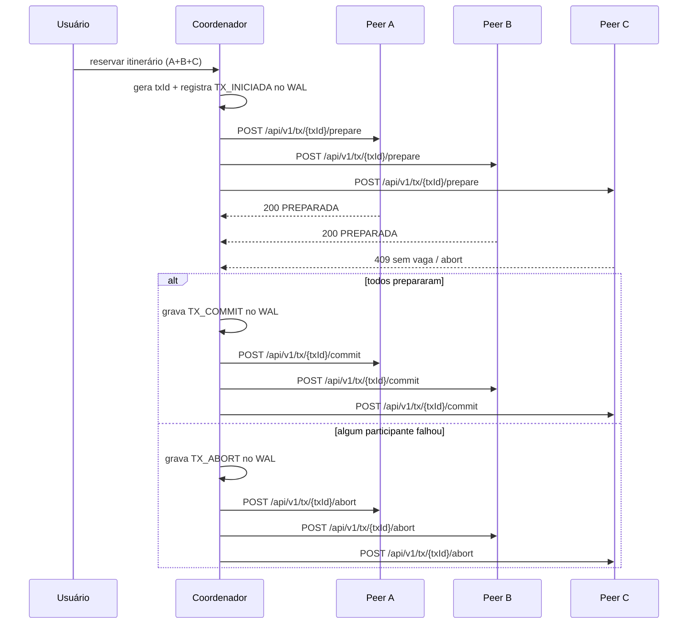
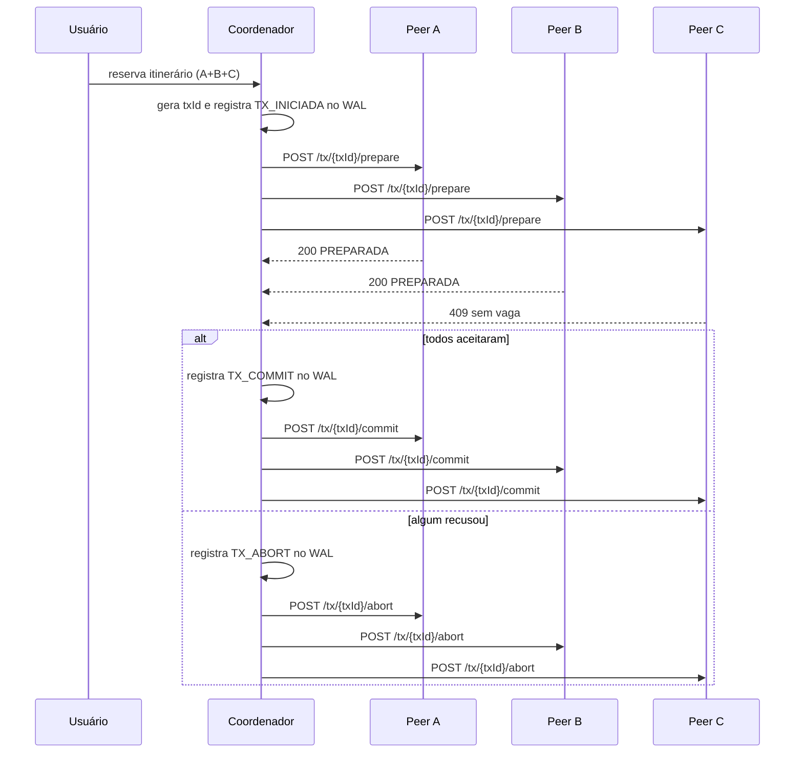

# VaiJunto 2

Este projeto implementa um consórcio de caronas compartilhadas entre empresas independentes. Cada empresa executa seu próprio servidor TCP para clientes e uma API REST para comunicação entre servidores.

## Arquitetura

- `vaijunto-server` contém a lógica de negócio, WAL, peer API e serviços de reserva.
- Cada instância tem:
  - `EMPRESA_ID`: identidade da empresa;
  - `PORTA_TCP`: porta para clientes;
  - `PORTA_HTTP`: porta da API REST entre servidores;
  - `PEERS`: lista de outros servidores do consórcio (formato `ID=http://host:porta`);
  - `CONSORCIO_TOKEN`: token compartilhado entre servidores para validar comunicação.
- O log WAL (`data/wal.log`) registra eventos antes de aplicar efeitos, permitindo recomeço em caso de falha.

## Fluxo de commit distribuído



## API entre servidores

Prefixo: `/api/v1`

### GET `/saude`
- Responde: `200 OK`
- Corpo:
  ```json
  {"empresaId":"EMPRESA_A","status":"OK"}
  ```

### GET `/trechos?data=YYYY-MM-DD`
- Responde: `200 OK`
- Corpo:
  ```json
  {
    "empresaId": "EMPRESA_A",
    "data": "2026-11-01",
    "trechos": [
      {"trechoId":"EMPRESA_A:carona-1:VALENTINE>RHODES","empresaId":"EMPRESA_A","caronaId":"carona-1","origem":"VALENTINE","destino":"RHODES","data":"2026-11-01","preco":25.0,"vagas":2}
    ]
  }
  ```

### POST `/reservas`
- Corpo:
  ```json
  {
    "passageiroLogin": "joao",
    "trechos": [
      {"caronaId":"carona-1","origem":"VALENTINE","destino":"RHODES","empresaId":"EMPRESA_A","data":"2026-11-01","preco":25.0,"vagas":2}
    ]
  }
  ```
- Respostas:
  - `200`: reserva confirmada
  - `409`: conflito de vagas ou rejeição do peer
  - `400`: payload inválido

### GET `/reservas/estado?idReserva=...&login=...`
- Responde: `200 OK` com:
  ```json
  {"status":"ATIVA","idReserva":"..."}
  ```

### POST `/tx/{txId}/prepare`
- Corpo:
  ```json
  {
    "login": "joao",
    "ttlMs": 10000,
    "trechos": [
      {"caronaId":"carona-1","origem":"VALENTINE","destino":"RHODES"}
    ]
  }
  ```
- Respostas:
  - `200`: `{"txId":"...","sucesso":true,"estado":"PREPARADA"}`
  - `409`: sem vaga / conflito

### POST `/tx/{txId}/commit`
- Responde: `200 OK` ou `409`

### POST `/tx/{txId}/abort`
- Responde: `200 OK` ou `409`

### GET `/tx/{txId}/estado`
- Responde:
  ```json
  {"txId":"...","estado":"PREPARADA|COMMIT|ABORT","empresaId":"EMPRESA_A"}
  ```

## Critério de precedência do último assento

O último assento é decidido pelo dono do trecho. Não há dependência de relógio de parede entre servidores. A disputa é serializada pelo lock do trecho no servidor responsável por aquele trecho; quem ganhar o lock primeiro confirma a reserva e quem perder recebe `409` e aborta. Assim, a decisão é determinística e não sofre com relógios desalinhados.

## Como subir 3 instâncias localmente

A pasta `vaijunto-server` já contém scripts e referência de configuração para iniciar três empresas. O ambiente deve usar um token compartilhado em todas as instâncias e nomes distintos de empresa.

Exemplo de variáveis:

```bash
export CONSORCIO_TOKEN=minha-chave
export EMPRESA_ID=EMPRESA_A
export PORTA_TCP=8080
export PORTA_HTTP=7070
export PEERS=EMPRESA_B=http://127.0.0.1:7071,EMPRESA_C=http://127.0.0.1:7072
```

Depois, inicie as três instâncias em portas diferentes e valide:

```bash
curl http://127.0.0.1:7070/api/v1/saude
curl http://127.0.0.1:7071/api/v1/saude
curl http://127.0.0.1:7072/api/v1/saude
```

## Simulador de passageiros

O cliente do projeto inclui um simulador de carga para exercitar o sistema com múltiplos passageiros concorrentes. Ele cria usuários, faz login, pesquisa viagens, seleciona itinerários e reserva assentos em sequência, usando todas as empresas configuradas.

```bash
cd vaijunto-client
./rodar-simulador.sh --usuarios=20 --iteracoes=5 --servidores=127.0.0.1:8080,127.0.0.1:8081,127.0.0.1:8082
```

Também é possível sobrescrever via propriedades do Java:

```bash
mvn -q -DskipTests compile exec:java \
  -Dexec.mainClass="simulador.SimuladorPassageiros" \
  -Dexec.args="--usuarios=50 --iteracoes=10 --servidores=127.0.0.1:8080,127.0.0.1:8081,127.0.0.1:8082"
```

## Observações de projeto

- A comunicação entre servidores é somente via HTTP, com token compartilhado em cabeçalho `X-Consorcio-Token`.
- O servidor não depende de um coordenador global ou banco compartilhado.
- A recuperação após queda é feita principalmente pelo WAL e por reprocessamento de transações pendentes.
- O protocolo implementado é um 2PC leve, com prepare, decisão e confirmação/aborto idempotente por `txId`.

## Visão do barema do problema 2

O problema 2 avalia a arquitetura distribuída do consórcio e exige que o sistema demonstre, ao mesmo tempo, coerência operacional e tolerância a falhas. Os itens abaixo resumem os pontos em que o sistema é cobrado na apresentação e no relatório.

### 1) Arquitetura

Cada empresa executa uma instância do backend com:

- `ServidorTCP`: recebe clientes locais e faz autenticação e operações do usuário;
- `ServidorApi`: expõe a API REST para comunicação com outras empresas;
- `GegenciarGeral`: coordena serviços de usuário, caronas e reservas;
- `Grafo`: mantém as caronas e trechos registrados na empresa;
- `Wal`: persiste eventos antes de aplicar efeitos;
- `ClienteConsorcio`: envia requisições para peers e trata falha de resposta como `PeerIndisponivelException`;
- `MonitorPeers`: verifica periodicamente a saúde dos outros servidores e detecta transições `ONLINE/OFFLINE`.

A principal diferença para a arquitetura centralizada do Problema 1 é que a decisão de assento passa a ser distribuída e local a cada empresa dona do trecho. Isso elimina um único ponto de falha, mas exige o uso de protocolo de coordenação, confirmação e tratamento de concorrência entre empresas distintas.

### 2) Comunicação (API REST)

A comunicação entre empresas usa HTTP, com prefixo `/api/v1`. Os principais recursos são:

- `GET /saude`: retorna `empresaId` e `status`;
- `GET /trechos?data=YYYY-MM-DD`: lista trechos disponíveis numa data;
- `POST /reservas`: confirma uma reserva remota; responde `200` em sucesso e `409` em conflito;
- `GET /reservas/estado?idReserva=...&login=...`: consulta estado da reserva;
- `POST /tx/{txId}/prepare`: prepara a transação de um itinerário em um peer;
- `POST /tx/{txId}/commit`: materializa o resultado positivo;
- `POST /tx/{txId}/abort`: cancela a transação;
- `GET /tx/{txId}/estado`: consulta o estado da transação local.

Cada chamada tem timeout configurado pelo cliente (`HttpClient` com timeout de 2 segundos) e falha de rede ou resposta inesperada é tratada como indisponibilidade do peer. Quando uma mesma requisição é repetida, o comportamento é idempotente por `txId` e por `idReserva`: a confirmação não deve criar efeitos duplicados e o servidor responde com o estado já conhecido em vez de repetir a operação.

### 3) Busca distribuída

A busca de itinerários envolve caronas publicadas em outras empresas. Um servidor cliente consulta primeiro os seus trechos locais e, em seguida, chama os peers para listar trechos disponíveis na data desejada. A estratégia adotada é uma consulta em tempo real sobre a base de cada empresa, sem depender de um banco global ou catálogo central.

Quando uma empresa fica fora do ar, o cliente não bloqueia a operação inteira: a falha é percebida como indisponibilidade do peer e a viagem pode continuar sendo montada com base nas empresas que responderam. O sistema preserva a funcionalidade da operação e trata a falha como um caso normal de participação parcial do consórcio.

### 4) Exclusão mútua

A exclusão mútua é implementada no nível do trecho, que é o recurso crítico do sistema. O objeto `Trecho` possui métodos sincronizados (`reservarLugar`, `liberarLugar`, leitura de disponibilidade), e cada operação que altera a contagem de vagas e a lista de passageiros é serializada pelo lock do próprio trecho.

Isso garante que o mesmo assento de um mesmo trecho não seja confirmado para dois passageiros em concorrência. A decisão da vaga é realizada pelo servidor que detém aquele trecho, que é a autoridade para validar a disponibilidade. Isso evita inconsistência mesmo quando requisições chegam simultaneamente de empresas distintas.

### 5) Atomicidade distribuída

A confirmação de um itinerário com trechos de empresas diferentes é feita por um protocolo leve de 2PC (two-phase commit):

1. O coordenador do itinerário gera um `txId` único;
2. os peers recebem `POST /tx/{txId}/prepare` com os trechos e o login;
3. cada par participa e responde `200 PREPARADA` ou `409` em caso de conflito;
4. se todos prepararem, o coordenador grava a transação como `COMMIT` no WAL e envia `commit` aos peers;
5. se algum participante recusar, o coordenador grava `ABORT` no WAL e notifica os demais peers para cancelar a operação.

A transação fica registrada em estado local (`INICIADA`, `PREPARADA`, `COMMIT`, `ABORT`, etc.) e pode ser reprocessada após falha. Quando um participante recusa, os trechos já reservados em outros participantes devem ser liberados para manter a atomicidade do itinerário completo.



### 6) Precedência do último assento

O critério usado é "quem detém o lock do trecho decide". Não existe dependência de relógio de parede nem comparação de timestamps entre empresas. Cada servidor serializa a disputa pelo trecho localmente; a primeira operação que obtém o lock do trecho ganha a reserva e a segunda recebe `409`, aborta e informa o cliente que a vaga foi perdida.

Isso é determinístico e permanece válido mesmo com atrasos de rede ou relógios desalinhados, porque a decisão se baseia na ordem local de aquisição do lock, e não na ordem de envio das mensagens.

### 7) Deadlock distribuído

A estratégia para evitar deadlocks é não permitir que duas transações adquiram recursos em ordens incompatíveis. A decisão de cada trecho é sempre centralizada no dono do trecho, e o lock do trecho funciona como unidade de serialização. Quando duas reservas tentam ocupar os mesmos trechos de empresas diferentes em ordens distintas, o conflito é resolvido pela ordem de aquisição do lock em cada empresa; não há ciclo de espera entre servidores.

O custo dessa escolha é que algumas requisições podem receber `409` e abortar quando houver disputa intensa, mas isso preserva a consistência do sistema e evita bloqueios permanentes.

### 8) Tolerância a falhas

O sistema trata a falha de um peer como parte do comportamento normal do ambiente distribuído.

- antes de uma confirmação: o peer pode estar indisponível e o cliente simplesmente não recebe resposta dentro do timeout;
- durante a confirmação: um peer pode falhar após aceitar `prepare` mas antes de receber `commit` ou `abort`; nisso, a transação continua pendente e será tratada por retry ou por reprocessamento do WAL;
- depois da confirmação: o servidor pode voltar e consultar o estado da transação, reaproveitando o estado persistido no log.

A detecção é feita por `MonitorPeers`, que roda `GET /saude` em intervalos regulares e registra a mudança de estado do peer. O restante do consórcio continua operando mesmo quando uma empresa cai, e os efeitos de um servidor indisponível ficam contidos na empresa específica sem derrubar todo o sistema.

### 9) Recuperação e persistência

A persistência é feita em WAL (`Write-Ahead Log`), que registra cada evento antes de aplicar o efeito correspondente. O log contém eventos como cadastro de usuários, criação de carona, criação e cancelamento de reservas e transações de coordenação.

O fluxo de recuperação é:

1. ao iniciar, o servidor lê o arquivo de log em ordem;
2. verifica CRC e descarta linha final incompleta em caso de queda abrupta;
3. reexecuta os eventos válidos para reconstruir o estado da empresa;
4. reprocessa reservas e transações pendentes de acordo com o estado do WAL;
5. volta a aceitar novas requisições sem perder consistência.

Além disso, as regras de idempotência evitam que operações repetidas criem efeitos duplicados. Esta capacidade de recuperação é o mecanismo central para garantir consistência após falha.

### 10) Testes

O projeto inclui testes de software para verificar concorrência e consistência. Os principais cenários cobertos são:

- cadastro simultâneo de muitos usuários distintos;
- rejeição de logins duplicados;
- reserva remota entre empresas diferentes;
- concorrência de múltiplos passageiros disputando o último assento;
- validação do comportamento de transação e devolução de estados em cenário de falha local.

A execução desses testes validou que a solução mantém a exclusão mútua e evita que o número de reservas ultrapasse a capacidade do trecho, mesmo sob carga concorrente.

### 11) Emulação em Docker

Os servidores do consórcio foram executados em containers Docker em computadores distintos do laboratório, usando `docker-compose.lab.yml` para levantar três empresas: `EMPRESA_A`, `EMPRESA_B` e `EMPRESA_C`.

Cada container expõe:

- TCP local de cliente em `127.0.0.1:8080`, `8081` e `8082`;
- HTTP de peer em `127.0.0.1:7070`, `7071` e `7072`;
- um volume dedicado para o diretório de dados da empresa;
- a mesma chave compartilhada `CONSORCIO_TOKEN` e listas de peers distintas.

A emulação da falha pode ser feita pela parada de um service do Docker (`docker compose stop empresa-b`, por exemplo). A apresentação pode então observar que os outros servidores continuam respondendo e que a empresa fora do ar é marcada como offline pelo monitor, com a operação do consórcio sendo retomada conforme o restante da infraestrutura continua ativa.


