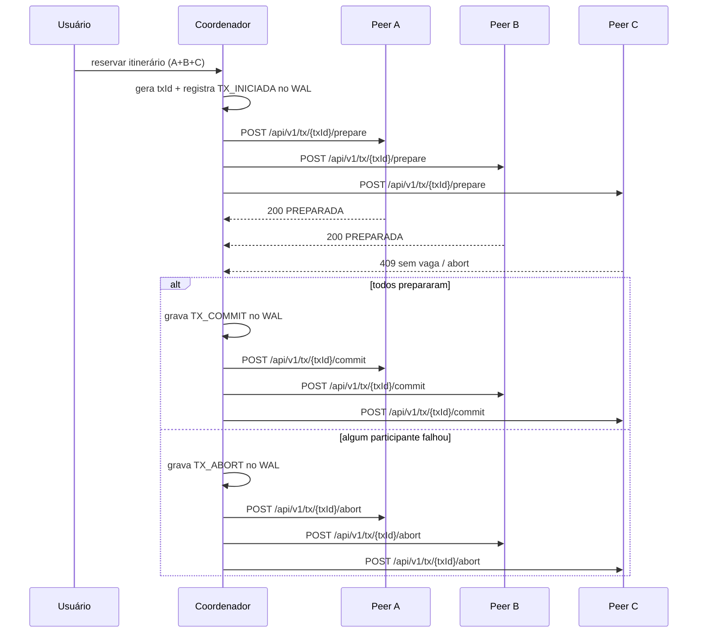
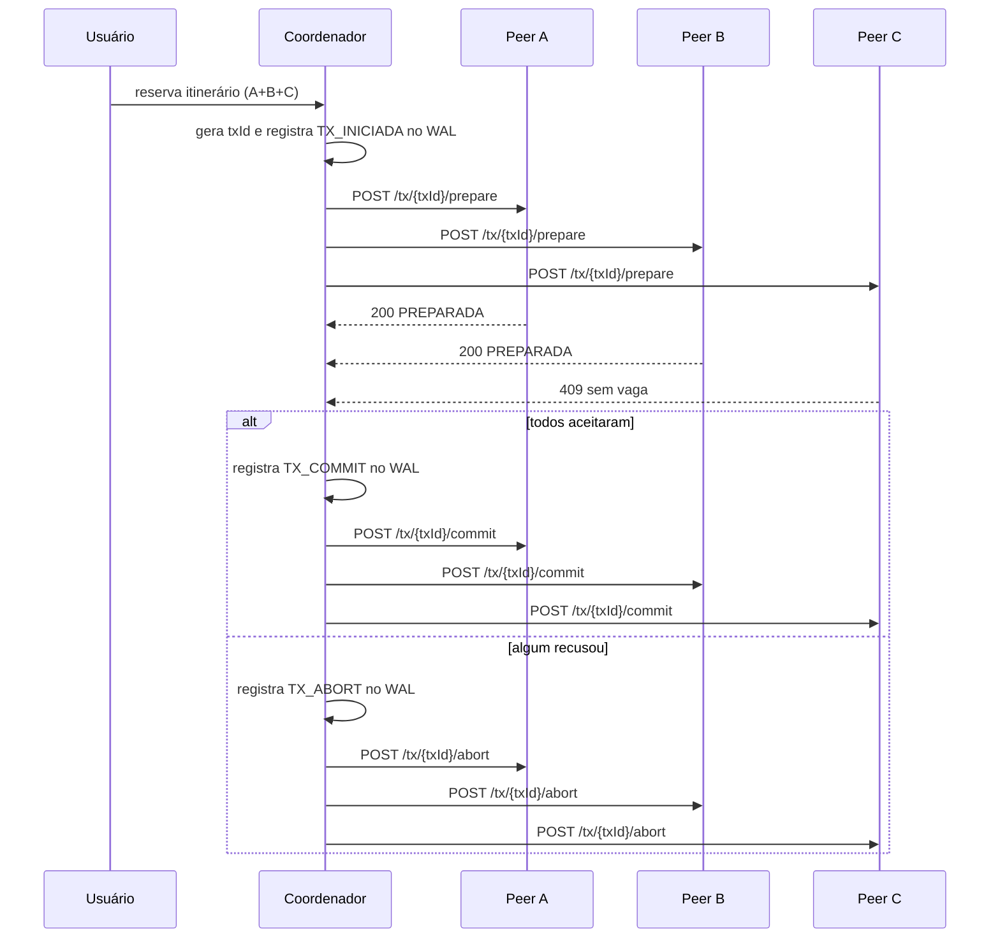

# VaiJunto 2

Este projeto implementa um consórcio de caronas compartilhadas entre empresas independentes. Cada empresa executa seu próprio servidor TCP para clientes e uma API REST para comunicação entre servidores.

## Arquitetura

- `vaijunto-server` contém a lógica de negócio, WAL, peer API e serviços de reserva.
- Cada instância tem:
  - `EMPRESA_ID`: identidade da empresa;
  - `PORTA_TCP`: porta para clientes;
  - `PORTA_HTTP`: porta da API REST entre servidores;
  - `PEERS`: lista de outros servidores do consórcio (formato `ID=http://host:porta`);
  - `CONSORCIO_TOKEN`: token compartilhado entre servidores para validar comunicação.
- O log WAL (`data/wal.log`) registra eventos antes de aplicar efeitos, permitindo recomeço em caso de falha.

## Fluxo de commit distribuído



## API entre servidores

Prefixo: `/api/v1`

### GET `/saude`
- Responde: `200 OK`
- Corpo:
  ```json
  {"empresaId":"EMPRESA_A","status":"OK"}
  ```

### GET `/trechos?data=YYYY-MM-DD`
- Responde: `200 OK`
- Corpo:
  ```json
  {
    "empresaId": "EMPRESA_A",
    "data": "2026-11-01",
    "trechos": [
      {"trechoId":"EMPRESA_A:carona-1:VALENTINE>RHODES","empresaId":"EMPRESA_A","caronaId":"carona-1","origem":"VALENTINE","destino":"RHODES","data":"2026-11-01","preco":25.0,"vagas":2}
    ]
  }
  ```

### POST `/reservas`
- Corpo:
  ```json
  {
    "passageiroLogin": "joao",
    "trechos": [
      {"caronaId":"carona-1","origem":"VALENTINE","destino":"RHODES","empresaId":"EMPRESA_A","data":"2026-11-01","preco":25.0,"vagas":2}
    ]
  }
  ```
- Respostas:
  - `200`: reserva confirmada
  - `409`: conflito de vagas ou rejeição do peer
  - `400`: payload inválido

### GET `/reservas/estado?idReserva=...&login=...`
- Responde: `200 OK` com:
  ```json
  {"status":"ATIVA","idReserva":"..."}
  ```

### POST `/tx/{txId}/prepare`
- Corpo:
  ```json
  {
    "login": "joao",
    "ttlMs": 10000,
    "trechos": [
      {"caronaId":"carona-1","origem":"VALENTINE","destino":"RHODES"}
    ]
  }
  ```
- Respostas:
  - `200`: `{"txId":"...","sucesso":true,"estado":"PREPARADA"}`
  - `409`: sem vaga / conflito

### POST `/tx/{txId}/commit`
- Responde: `200 OK` ou `409`

### POST `/tx/{txId}/abort`
- Responde: `200 OK` ou `409`

### GET `/tx/{txId}/estado`
- Responde:
  ```json
  {"txId":"...","estado":"PREPARADA|COMMIT|ABORT","empresaId":"EMPRESA_A"}
  ```

## Critério de precedência do último assento

O último assento é decidido pelo dono do trecho. Não há dependência de relógio de parede entre servidores. A disputa é serializada pelo lock do trecho no servidor responsável por aquele trecho; quem ganhar o lock primeiro confirma a reserva e quem perder recebe `409` e aborta. Assim, a decisão é determinística e não sofre com relógios desalinhados.

## Como subir 3 instâncias localmente

A pasta `vaijunto-server` já contém scripts e referência de configuração para iniciar três empresas. O ambiente deve usar um token compartilhado em todas as instâncias e nomes distintos de empresa.

Exemplo de variáveis:

```bash
export CONSORCIO_TOKEN=minha-chave
export EMPRESA_ID=EMPRESA_A
export PORTA_TCP=8080
export PORTA_HTTP=7070
export PEERS=EMPRESA_B=http://127.0.0.1:7071,EMPRESA_C=http://127.0.0.1:7072
```

Depois, inicie as três instâncias em portas diferentes e valide:

```bash
curl http://127.0.0.1:7070/api/v1/saude
curl http://127.0.0.1:7071/api/v1/saude
curl http://127.0.0.1:7072/api/v1/saude
```

## Simulador de passageiros

O cliente do projeto inclui um simulador de carga para exercitar o sistema com múltiplos passageiros concorrentes. Ele cria usuários, faz login, pesquisa viagens, seleciona itinerários e reserva assentos em sequência, usando todas as empresas configuradas.

```bash
cd vaijunto-client
./rodar-simulador.sh --usuarios=20 --iteracoes=5 --servidores=127.0.0.1:8080,127.0.0.1:8081,127.0.0.1:8082
```

Também é possível sobrescrever via propriedades do Java:

```bash
mvn -q -DskipTests compile exec:java \
  -Dexec.mainClass="simulador.SimuladorPassageiros" \
  -Dexec.args="--usuarios=50 --iteracoes=10 --servidores=127.0.0.1:8080,127.0.0.1:8081,127.0.0.1:8082"
```

## Observações de projeto

- A comunicação entre servidores é somente via HTTP, com token compartilhado em cabeçalho `X-Consorcio-Token`.
- O servidor não depende de um coordenador global ou banco compartilhado.
- A recuperação após queda é feita principalmente pelo WAL e por reprocessamento de transações pendentes.
- O protocolo implementado é um 2PC leve, com prepare, decisão e confirmação/aborto idempotente por `txId`.

## Visão do barema do problema 2

O Problema 2 tem como objetivo avaliar a arquitetura distribuída do consórcio de caronas compartilhadas, exigindo não apenas a funcionalidade do sistema, mas também a demonstração de consistência, concorrência controlada, tolerância a falhas e recuperação após interrupções. A solução proposta foi concebida para operar sem um coordenador global centralizado, mantendo o controle de vagas e da confirmação de reservas de forma local e distribuída entre as empresas participantes.

### 1) Arquitetura do sistema

Cada empresa participante do consórcio executa uma instância independente do backend, composta por diversos módulos com funções específicas:

- `ServidorTCP`: responsável por receber os clientes locais, autenticar usuários e processar operações do motorista e do passageiro;
- `ServidorApi`: expõe a API REST utilizada na comunicação entre empresas do consórcio;
- `GegenciarGeral`: centraliza a lógica de negócio e coordena os serviços de usuário, caronas e reservas;
- `Grafo`: mantém a representação das caronas e trechos da empresa;
- `Wal`: registra eventos essenciais em log de escrita antecipada, antes da aplicação dos efeitos de negócio;
- `ClienteConsorcio`: executa chamadas HTTP aos peers e trata falhas de comunicação como indisponibilidade do servidor remoto;
- `MonitorPeers`: realiza verificação periódica da disponibilidade dos demais servidores e registra mudanças de estado (`ONLINE`/`OFFLINE`).

A arquitetura do presente projeto difere da abordagem centralizada do Problema 1, no qual a decisão sobre disponibilidade e confirmação era concentrada em um único ponto. No modelo distribuído adotado, cada empresa é responsável por seus trechos e pelo controle local de vagas. Essa mudança reduz o ponto único de falha, mas exige mecanismos explícitos de coordenação entre empresas, recuperação de estado e tratamento de concorrência.

### 2) Comunicação entre servidores via API REST

A comunicação entre as empresas do consórcio é realizada por meio de HTTP, com prefixo `/api/v1` e autenticação por cabeçalho `X-Consorcio-Token`. Os principais recursos expostos são os seguintes:

- `GET /saude`: responde com o identificador da empresa e o status do servidor;
- `GET /trechos?data=YYYY-MM-DD`: retorna os trechos disponíveis em uma determinada data;
- `POST /reservas`: confirma uma reserva remota e retorna `200` em caso de sucesso ou `409` em caso de conflito;
- `GET /reservas/estado?idReserva=...&login=...`: consulta o estado de uma reserva;
- `POST /tx/{txId}/prepare`: prepara a transação de um itinerário em um peer;
- `POST /tx/{txId}/commit`: confirma a transação;
- `POST /tx/{txId}/abort`: aborta a transação;
- `GET /tx/{txId}/estado`: consulta o estado atual da transação.

As requisições entre servidores possuem timeout configurado no cliente, de modo que falhas de rede ou respostas demoradas são tratadas como indisponibilidade do peer. Além disso, a operação foi projetada para ser idempotente por `txId` e por `idReserva`, de modo que a repetição de uma mesma requisição não resulte em efeitos duplicados nem em inconsistência do estado global do consórcio.

### 3) Busca distribuída de itinerários

A busca por itinerários em empresas distintas é realizada mediante consulta em tempo real aos servidores dos peers. Quando um cliente solicita uma viagem, o servidor local consulta primeiro os trechos da própria empresa e, em seguida, chama as demais empresas para listar trechos de interesse em uma determinada data.

A estratégia adotada usa a base local de cada empresa como fonte de verdade para o conhecimento dos trechos e, portanto, evita a necessidade de um catálogo centralizado ou de um banco compartilhado. Caso uma empresa esteja indisponível, o funcionamento do consórcio não é interrompido em sua totalidade: as operações continuam considerando somente as empresas respondentes, e a falha é tratada como um caso normal de participação parcial do sistema distribuído.

### 4) Exclusão mútua de assentos

A exclusão mútua é obtida no nível do trecho, que constitui o recurso crítico do sistema. Cada instância de `Trecho` encapsula a lógica de controle de vagas e a lista de passageiros confirmados. Os métodos que alteram a disponibilidade do trecho são sincronizados, de modo que a atualização da contagem de assentos e da lista de passageiros é serializada por um lock local.

Esse mecanismo garante que o mesmo assento de um mesmo trecho não seja confirmado para dois passageiros simultaneamente, mesmo quando requisições concorrentes chegam de diferentes empresas. A empresa dona do trecho é a autoridade responsável pela validação da disponibilidade, o que resolve o conflito deterministically e evita inconsistência de estado.

### 5) Atomicidade distribuída da confirmação de itinerários

A confirmação de um itinerário que envolve trechos de empresas diferentes é implementada por meio de um protocolo leve de 2PC (two-phase commit). O processo segue os seguintes passos:

1. O coordenador da transação gera um identificador único `txId`;
2. cada peer recebe uma requisição `POST /tx/{txId}/prepare` com o login do passageiro e os trechos envolvidos;
3. o participante avalia a disponibilidade e responde `200` com `PREPARADA` ou `409` em caso de conflito;
4. se todos os participantes prepararem a transação, o coordenador registra a decisão no WAL e envia `commit` aos peers;
5. caso algum participante recuse, o coordenador registra `ABORT` no WAL e envia `abort` aos demais participantes para que os trechos já reservados sejam liberados.

A transação possui estados locais bem definidos (`INICIADA`, `PREPARADA`, `COMMIT`, `ABORT`, e variações de confirmação), permitindo reprocessamento após falhas. O uso de `txId` garante idempotência e possibilita que a operação seja retomada sem duplicar efeitos colaterais no consórcio.



### 6) Critério de precedência do último assento

Para decidir qual passageiro permanece com o último assento de um trecho quando há concorrência entre diferentes empresas, o sistema adota o critério de que a empresa dona do trecho é responsável pela decisão. A disputa é serializada pelo lock do trecho em seu servidor local, e a primeira operação que obtém o lock ganha a vaga. A segunda operação, ao não conseguir adquirir o lock, recebe `409` e conclui em aborto.

Esse critério é adequado para um ambiente sem sincronização de relógios entre servidores, pois não depende de marcação temporal global ou de relógios de parede. A decisão é baseada na ordem local de aquisição do lock e, consequentemente, é determinística mesmo diante de atrasos na rede ou desalinhos temporais entre os nós.

### 7) Deadlock distribuído

A solução evitou a formação de deadlocks distribuídos ao não permitir que transações concorrentes adquiram recursos em ordens inconsistentes. Como cada trecho é controlado por seu servidor proprietário e a concessão da reserva é tratada por lock local, não há ciclo de espera entre empresas. Quando duas transações competem por trechos em ordem distinta, uma delas é abortada e a outra continua, evitando bloqueio permanente.

Esse mecanismo reduz o risco de impasse, embora implique que algumas requisições sejam rejeitadas em cenários de alta concorrência. Em compensação, o sistema preserva a consistência do estado e evita que o consórcio fique bloqueado por espera circular.

### 8) Tolerância a falhas

A tolerância a falhas foi considerada como requisito central do projeto. Quando um peer falha antes da confirmação de um itinerário, a operação simplesmente não recebe resposta em tempo hábil e é tratada como indisponibilidade transitória. Quando a falha ocorre durante a execução da transação, a operação pode ficar pendente até que o servidor retorne e reprocessa o estado persistido em log. Quando a falha acontece após a confirmação, o sistema usa o registro de eventos para restaurar o estado correto ao reiniciar o serviço.

A detecção de indisponibilidade é feita pelo `MonitorPeers`, que executa verificações periódicas de saúde em cada peer e registra eventos de mudança de estado. Esse mecanismo permite que o restante do consórcio continue operando mesmo quando uma empresa deixa de responder, sem comprometer a disponibilidade geral do sistema.

### 9) Recuperação e persistência

A recuperação do estado do sistema é implementada por meio de WAL (`Write-Ahead Log`). Cada evento relevante do sistema, como cadastro de usuários, criação de carona, reserva e transações distribuídas, é registrado antes da aplicação do efeito correspondente. Esse procedimento garante que a confirmação do evento seja durável mesmo em caso de interrupção abrupta.

Ao reiniciar um servidor, o sistema realiza os seguintes passos:

1. lê o arquivo de log em ordem;
2. valida o CRC de cada entrada;
3. descarta a última linha truncada ou incompleta em cenários de queda abrupta;
4. reprocessa os eventos válidos para reconstruir o estado da empresa;
5. retoma a operação normal sem inconsistências causadas por falha externa.

A persistência em WAL e o uso de identificadores de transação (`txId`) são fundamentais para a garantia de consistência e idempotência após recuperação, evitando que reservas ou confirmações sejam aplicadas mais de uma vez.

### 10) Testes de validação

Para validar o comportamento do sistema, foram desenvolvidos testes focados em concorrência e consistência. Os principais cenários avaliados incluem:

- cadastro simultâneo de múltiplos usuários distintos;
- rejeição de cadastro de mesmo login em concorrência;
- reserva remota entre empresas distintas;
- disputa por último assento por vários passageiros simultaneamente;
- recuperação do estado de transações após falha local.

Os testes demonstraram que a solução preserva a exclusão mútua, limita o número de confirmações ao número de vagas disponíveis e mantém o comportamento do consórcio estável sob carga concorrente.

### 11) Emulação em Docker

Os servidores do consórcio foram executados em contêineres Docker em máquinas distintas do laboratório, utilizando o arquivo `docker-compose.lab.yml` para orquestrar três empresas: `EMPRESA_A`, `EMPRESA_B` e `EMPRESA_C`.

Cada contêiner expõe:

- porta TCP para clientes locais em `127.0.0.1:8080`, `8081` e `8082`;
- porta HTTP de comunicação entre peers em `127.0.0.1:7070`, `7071` e `7072`;
- volume dedicado para armazenamento local da empresa;
- uma chave compartilhada `CONSORCIO_TOKEN` e lista de peers específica para cada instância.

Durante a apresentação, a falha de uma empresa pode ser simulada pela interrupção do contêiner correspondente. A observação do sistema em execução permite verificar que os outros servidores continuam respondendo e que a empresa fora do ar é sinalizada como indisponível pelo monitor, sem interromper completamente o funcionamento do consórcio.

## Checklist para apresentação

Durante a apresentação do projeto, o grupo deve demonstrar, de forma objetiva e completa, os seguintes aspectos:

- operação do consórcio com três empresas em funcionamento;
- busca de itinerários entre empresas distintas;
- processamento de reservas concorrentes e tratamento de conflitos;
- execução do protocolo de `prepare`, `commit` e `abort`;
- recuperação de estado após falha de uma empresa;
- observação do comportamento do monitor de peers e da continuação do funcionamento do consórcio em presença de indisponibilidade.

Esses elementos estão diretamente alinhados com o barema do Problema 2 e permitem validar tanto a funcionalidade da solução quanto sua robustez em um ambiente distribuído e sujeito a falhas.
