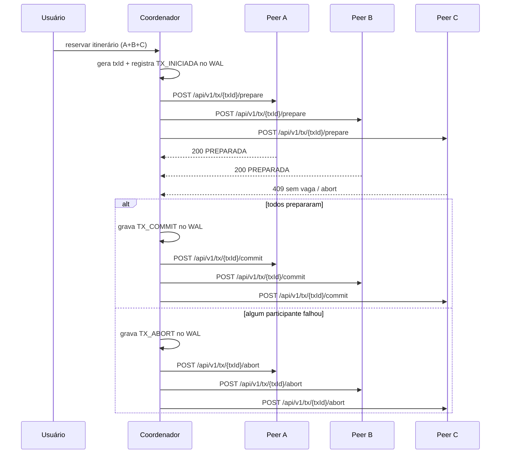

# VaiJunto 2

Este projeto implementa um consórcio de caronas compartilhadas entre empresas independentes. Cada empresa executa seu próprio servidor TCP para clientes e uma API REST para comunicação entre servidores.

## Arquitetura

- `vaijunto-server` contém a lógica de negócio, WAL, peer API e serviços de reserva.
- Cada instância tem:
  - `EMPRESA_ID`: identidade da empresa;
  - `PORTA_TCP`: porta para clientes;
  - `PORTA_HTTP`: porta da API REST entre servidores;
  - `PEERS`: lista de outros servidores do consórcio (formato `ID=http://host:porta`);
  - `CONSORCIO_TOKEN`: token compartilhado entre servidores para validar comunicação.
- O log WAL (`data/wal.log`) registra eventos antes de aplicar efeitos, permitindo recomeço em caso de falha.

## Fluxo de commit distribuído



## API entre servidores

Prefixo: `/api/v1`

### GET `/saude`
- Responde: `200 OK`
- Corpo:
  ```json
  {"empresaId":"EMPRESA_A","status":"OK"}
  ```

### GET `/trechos?data=YYYY-MM-DD`
- Responde: `200 OK`
- Corpo:
  ```json
  {
    "empresaId": "EMPRESA_A",
    "data": "2026-11-01",
    "trechos": [
      {"trechoId":"EMPRESA_A:carona-1:VALENTINE>RHODES","empresaId":"EMPRESA_A","caronaId":"carona-1","origem":"VALENTINE","destino":"RHODES","data":"2026-11-01","preco":25.0,"vagas":2}
    ]
  }
  ```

### POST `/reservas`
- Corpo:
  ```json
  {
    "passageiroLogin": "joao",
    "trechos": [
      {"caronaId":"carona-1","origem":"VALENTINE","destino":"RHODES","empresaId":"EMPRESA_A","data":"2026-11-01","preco":25.0,"vagas":2}
    ]
  }
  ```
- Respostas:
  - `200`: reserva confirmada
  - `409`: conflito de vagas ou rejeição do peer
  - `400`: payload inválido

### GET `/reservas/estado?idReserva=...&login=...`
- Responde: `200 OK` com:
  ```json
  {"status":"ATIVA","idReserva":"..."}
  ```

### POST `/tx/{txId}/prepare`
- Corpo:
  ```json
  {
    "login": "joao",
    "ttlMs": 10000,
    "trechos": [
      {"caronaId":"carona-1","origem":"VALENTINE","destino":"RHODES"}
    ]
  }
  ```
- Respostas:
  - `200`: `{"txId":"...","sucesso":true,"estado":"PREPARADA"}`
  - `409`: sem vaga / conflito

### POST `/tx/{txId}/commit`
- Responde: `200 OK` ou `409`

### POST `/tx/{txId}/abort`
- Responde: `200 OK` ou `409`

### GET `/tx/{txId}/estado`
- Responde:
  ```json
  {"txId":"...","estado":"PREPARADA|COMMIT|ABORT","empresaId":"EMPRESA_A"}
  ```

## Critério de precedência do último assento

O último assento é decidido pelo dono do trecho. Não há dependência de relógio de parede entre servidores. A disputa é serializada pelo lock do trecho no servidor responsável por aquele trecho; quem ganhar o lock primeiro confirma a reserva e quem perder recebe `409` e aborta. Assim, a decisão é determinística e não sofre com relógios desalinhados.

## Como subir 3 instâncias localmente

A pasta `vaijunto-server` já contém scripts e referência de configuração para iniciar três empresas. O ambiente deve usar um token compartilhado em todas as instâncias e nomes distintos de empresa.

Exemplo de variáveis:

```bash
export CONSORCIO_TOKEN=minha-chave
export EMPRESA_ID=EMPRESA_A
export PORTA_TCP=8080
export PORTA_HTTP=7070
export PEERS=EMPRESA_B=http://127.0.0.1:7071,EMPRESA_C=http://127.0.0.1:7072
```

Depois, inicie as três instâncias em portas diferentes e valide:

```bash
curl http://127.0.0.1:7070/api/v1/saude
curl http://127.0.0.1:7071/api/v1/saude
curl http://127.0.0.1:7072/api/v1/saude
```

## Simulador de passageiros

O cliente do projeto inclui um simulador de carga para exercitar o sistema com múltiplos passageiros concorrentes. Ele cria usuários, faz login, pesquisa viagens, seleciona itinerários e reserva assentos em sequência, usando todas as empresas configuradas.

```bash
cd vaijunto-client
./rodar-simulador.sh --usuarios=20 --iteracoes=5 --servidores=127.0.0.1:8080,127.0.0.1:8081,127.0.0.1:8082
```

Também é possível sobrescrever via propriedades do Java:

```bash
mvn -q -DskipTests compile exec:java \
  -Dexec.mainClass="simulador.SimuladorPassageiros" \
  -Dexec.args="--usuarios=50 --iteracoes=10 --servidores=127.0.0.1:8080,127.0.0.1:8081,127.0.0.1:8082"
```

## Observações de projeto

- A comunicação entre servidores é somente via HTTP, com token compartilhado em cabeçalho `X-Consorcio-Token`.
- O servidor não depende de um coordenador global ou banco compartilhado.
- A recuperação após queda é feita principalmente pelo WAL e por reprocessamento de transações pendentes.
- O protocolo implementado é um 2PC leve, com prepare, decisão e confirmação/aborto idempotente por `txId`.
